# Week 6 — Part 1: Dataset download and validation

This part only **downloads and validates** the two image datasets used by the
Week 6 exercise. No models, figures, or Part 2 work are included here.

| Dataset  | Train images | Test images | Image shape   | Pixel range | Classes |
|----------|-------------:|------------:|---------------|-------------|--------:|
| MNIST    | 60,000       | 10,000      | `28 x 28` (1) | 0–255       | 10      |
| CIFAR-10 | 50,000       | 10,000      | `32 x 32 x 3` | 0–255       | 10      |

All downloads and integrity checks passed on 2026-10-28 (UTC).

## Provenance and download URLs

### MNIST

- **Original source:** Yann LeCun, Corinna Cortes, Christopher J.C. Burges,
  *The MNIST database of handwritten digits*,
  <http://yann.lecun.com/exdb/mnist/>.
- **Downloaded from (mirror):** the Common Visual Data Foundation (CVDF)
  mirror on Google Cloud Storage,
  <https://storage.googleapis.com/cvdf-datasets/mnist>.
- **Files:** `train-images-idx3-ubyte.gz`, `train-labels-idx1-ubyte.gz`,
  `t10k-images-idx3-ubyte.gz`, `t10k-labels-idx1-ubyte.gz`.
- **Local location:** `week6/inputs/mnist/`.
- The MD5 sums below match the `md5=` value in the objects' `x-goog-hash`
  response headers, so the mirror is byte-identical to the published files.

### CIFAR-10 (binary version)

- **Original source:** Alex Krizhevsky, *Learning Multiple Layers of Features
  from Tiny Images* (2009), University of Toronto,
  <https://www.cs.toronto.edu/~kriz/cifar.html>.
- **Downloaded from (mirror):** the MindSpore notebook dataset bucket on
  Huawei Cloud OBS,
  <https://mindspore-website.obs.cn-north-4.myhuaweicloud.com/notebook/datasets/cifar-10-binary.tar.gz>.
- **Local location:** `week6/inputs/cifar10/` (tarball plus the extracted
  `cifar-10-batches-bin/` directory).
- The binary version is used (not `cifar-10-python.tar.gz`): its class names
  ship as plain text in `batches.meta.txt`, and each batch stores records as
  `1 label byte + 3 x 1024 channel bytes` (R plane, G plane, B plane).

## Checksums (verified)

| File                                   | Size (bytes) | MD5                                |
|----------------------------------------|-------------:|------------------------------------|
| `train-images-idx3-ubyte.gz`           |    9,912,422 | `f68b3c2dcbeaaa9fbdd348bbdeb94873` |
| `train-labels-idx1-ubyte.gz`           |       28,881 | `d53e105ee54ea40749a09fcbcd1e9432` |
| `t10k-images-idx3-ubyte.gz`            |    1,648,877 | `9fb629c4189551a2d022fa330f9573f3` |
| `t10k-labels-idx1-ubyte.gz`            |        4,542 | `ec29112dd5afa0611ce80d1b7f02629c` |
| `cifar-10-binary.tar.gz`               |  170,052,171 | `c32a1d4ab5d03f1284b67883e8d87530` |

Note: `c58f30108f718f92721af3b95e74349a` is the MD5 of the *Python* CIFAR-10
tarball, not the binary one. The binary tarball used here is `c32a1d4a…`.

## Validation results (parsed from the original binary formats)

MNIST IDX format: 4-byte magic (`0x00000803` for images, `0x00000801` for
labels), then dimensions/count, then raw `uint8` pixels or labels.

```
MNIST (28x28 grayscale, 10 digit classes)
  train  images=60000  shape=(60000, 28, 28)  pixels=[0, 255]  labels=60000
         per-class counts: [5923, 6742, 5958, 6131, 5842, 5421, 5918, 6265, 5851, 5949]
  test   images=10000  shape=(10000, 28, 28)  pixels=[0, 255]  labels=10000
         per-class counts: [980, 1135, 1032, 1010, 982, 892, 958, 1028, 974, 1009]
```

CIFAR-10 binary format: each record is 3,073 bytes (`1` label byte + `3,072`
pixel bytes), reshaped to `(32, 32, 3)` RGB.

```
CIFAR-10 (32x32x3 RGB, 10 object classes)
  train  images=50000  shape=(50000, 32, 32, 3)  pixels=[0, 255]  labels=50000
         per-class counts: [5000, 5000, 5000, 5000, 5000, 5000, 5000, 5000, 5000, 5000]
  test   images=10000  shape=(10000, 32, 32, 3)  pixels=[0, 255]  labels=10000
         per-class counts: [1000, 1000, 1000, 1000, 1000, 1000, 1000, 1000, 1000, 1000]
  classes: ['airplane', 'automobile', 'bird', 'cat', 'deer', 'dog', 'frog', 'horse', 'ship', 'truck']
```

The full run is saved in `evidence/dataset-validation.txt`.

## What is preserved

- The **original train/test splits** (60k/10k for MNIST, 50k/10k for CIFAR-10);
  batches are concatenated in file order (`data_batch_1` … `data_batch_5`),
  with no shuffling.
- **Image-label pairing** follows the record order of the source files. The
  tests check parsed labels against the raw label bytes/records, and that
  re-reading the data is deterministic.
- **CIFAR-10 class balance**: exactly 5,000 training and 1,000 test images per
  class.
- **MNIST class counts** match the official training/test histograms.

## VERIFY (1): MNIST distribution figure

`plot_mnist_distribution.py` reuses the verified files in `inputs/mnist/`
(no re-download) and renders a two-panel figure following the reference on
page 4 of the Week 6 learning sheet:

- **Left:** the first two *training* images of every digit 0–9, in stored
  order, at native 28×28 resolution with `interpolation="nearest"` (no
  smoothing), each row labeled with its digit.
- **Right:** grouped bars comparing the per-class fractions of the 60,000
  training and 10,000 test images.

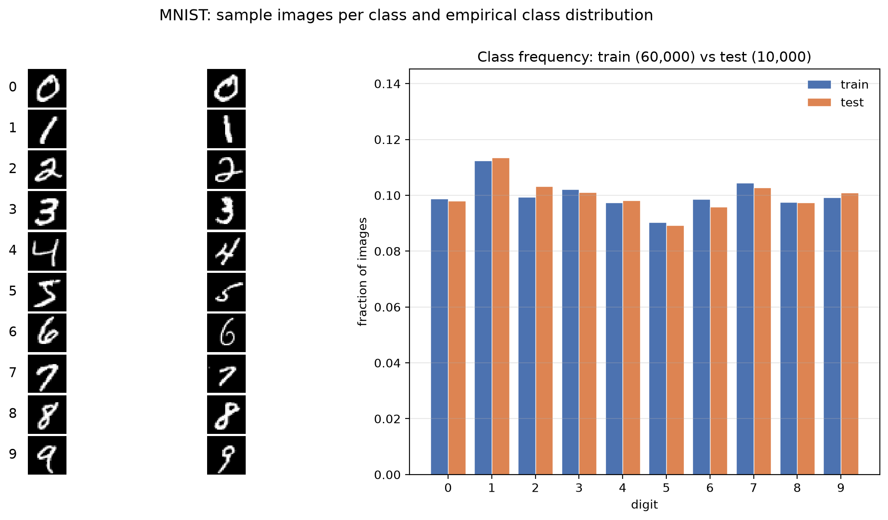

Reproduce with:

```sh
cd week6
.venv/bin/python plot_mnist_distribution.py   # writes evidence/mnist_distribution.png
.venv/bin/python -m pytest -q                 # includes the VERIFY (1) tests
```

The later `plot_mnist_distribution.py` run also writes the
`evidence/mnist-distribution-verify.txt` log. Numerical verification:

| digit | train n | train fraction | test n | test fraction |
|------:|--------:|---------------:|-------:|--------------:|
| 0 | 5923 | 0.0987 | 980 | 0.0980 |
| 1 | 6742 | **0.1124** | 1135 | **0.1135** |
| 2 | 5958 | 0.0993 | 1032 | 0.1032 |
| 3 | 6131 | 0.1022 | 1010 | 0.1010 |
| 4 | 5842 | 0.0974 | 982 | 0.0982 |
| 5 | 5421 | **0.0903** | 892 | **0.0892** |
| 6 | 5918 | 0.0986 | 958 | 0.0958 |
| 7 | 6265 | 0.1044 | 1028 | 0.1028 |
| 8 | 5851 | 0.0975 | 974 | 0.0974 |
| 9 | 5949 | 0.0992 | 1009 | 0.1009 |
| **sum** | **60000** | **1.0000** | **10000** | **1.0000** |

Verified properties:

- All ten digit classes 0–9 are present and labeled; each gallery image is
  the exact source `uint8` array of a training row whose label equals the row
  label (tested against the raw data).
- Digit **1** has the highest frequency and digit **5** the lowest, in both
  splits.
- Fractions sum to 1 for each split (60,000 and 10,000 images).
- The train/test assignments and the MNIST files are unchanged (counts match
  the official histograms and the MD5 checksums still pass).

## VERIFY (2): CIFAR-10 distribution figure

`plot_cifar10_distribution.py` reuses both the verified CIFAR-10 files in
`inputs/cifar10/` (no re-download) and the shared layout utilities in
`distribution_plotting.py` (the same code behind the MNIST figure).

- **Left:** the first two *training* images of each of the 10 object classes,
  in stored order, at native **32×32×3 RGB** resolution with
  `interpolation="nearest"` (no smoothing), each row labeled with its class.
- **Right:** grouped bars comparing the per-class fractions of the 50,000
  training and 10,000 test images; every bar is exactly 0.1.

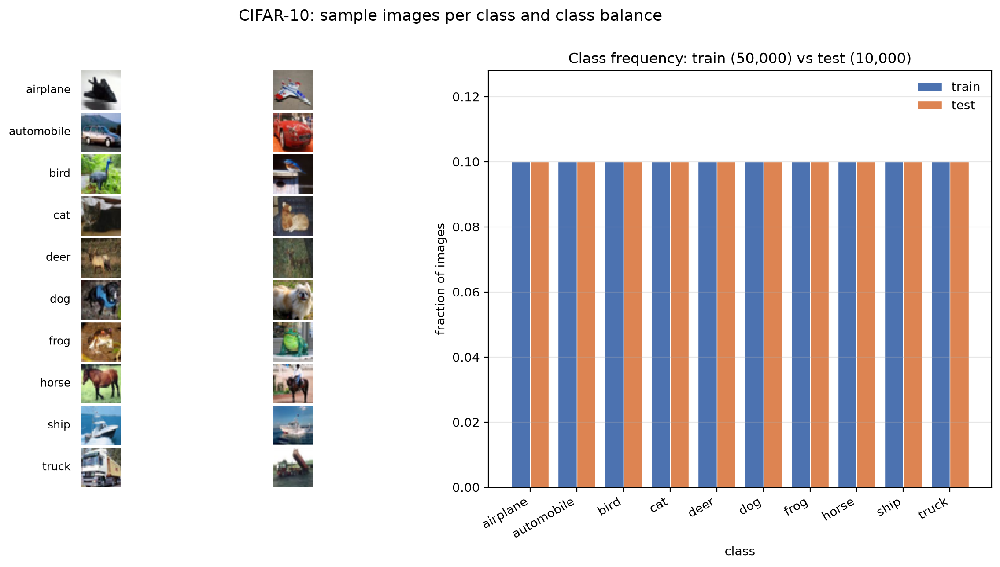

Reproduce with:

```sh
cd week6
.venv/bin/python plot_cifar10_distribution.py   # writes evidence/cifar10_distribution.png
.venv/bin/python -m pytest -q                   # includes the VERIFY (2) tests
```

A run also writes the `evidence/cifar10-distribution-verify.txt` log.

| class | train n | train fraction | test n | test fraction |
|-------|--------:|---------------:|-------:|--------------:|
| airplane | 5000 | 0.1 | 1000 | 0.1 |
| automobile | 5000 | 0.1 | 1000 | 0.1 |
| bird | 5000 | 0.1 | 1000 | 0.1 |
| cat | 5000 | 0.1 | 1000 | 0.1 |
| deer | 5000 | 0.1 | 1000 | 0.1 |
| dog | 5000 | 0.1 | 1000 | 0.1 |
| frog | 5000 | 0.1 | 1000 | 0.1 |
| horse | 5000 | 0.1 | 1000 | 0.1 |
| ship | 5000 | 0.1 | 1000 | 0.1 |
| truck | 5000 | 0.1 | 1000 | 0.1 |
| **sum** | **50000** | **1.0** | **10000** | **1.0** |

Verified properties:

- Training set has **50,000** images and the test set **10,000**.
- Every class has exactly **5,000** training and **1,000** test images;
  each class frequency is exactly **0.1** in both splits.
- All three RGB channels are decoded in the documented order (R plane, then
  G, then B), independently re-decoded from the raw `.bin` records in the
  tests; pixel values span 0–255.
- The original image-label pairing and stored order are preserved, and the
  archive MD5 checksum still matches.

## MNIST vs CIFAR-10

- **Image representation and resolution.** MNIST images are single-channel
  grayscale at 28×28 (784 values each), so a gallery mostly shows stroke
  shape and intensity. CIFAR-10 images are three-channel RGB at 32×32×3
  (3,072 values each), so the gallery also conveys colour and richer texture.
- **Class frequency distributions.** MNIST is imbalanced: digit 1 is the most
  frequent (≈0.112 train / 0.114 test) and digit 5 the least (≈0.090 / 0.089),
  with visible train/test differences. CIFAR-10 is exactly balanced: every
  class is 0.1 in both splits, so all bars have the same height.
- **What the panels show.** The gallery reveals what the pixels look like and
  whether labels match the visual content (digit shapes vs. objects and
  colours), while the frequency plot reveals dataset balance and split
  consistency. The gallery cannot show class proportions, and the bar chart
  cannot show image content — together they characterize the dataset.

## Part 2 — basic RBM and VERIFY (1)

### Reproducible JAX CPU environment (uv)

The environment is pinned in `pyproject.toml`, locked in `uv.lock`, and uses
**Python 3.14** (`.python-version`). JAX `0.12.0.1` provides CPU wheels for
Python 3.14, so the system interpreter is compatible and no alternative
Python version is needed; Week 5's environment is untouched.

```sh
cd week6
uv sync        # creates .venv from the lock file
uv run python -c "import jax; print(jax.__version__, jax.devices())"
```

Verified: `jax 0.12.0.1`, `jaxlib 0.12.0.1`, device `CpuDevice`, float32
default; array/matmul/sigmoid/Bernoulli operations run correctly.

Pinned packages: `jax==0.12.0.1`, `jaxlib==0.12.0.1`, `numpy==2.5.4`,
`matplotlib==3.11.2`, `pytest==9.2.0`.

### Configuration (`rbm.toml`)

Settings transcribed from the learning sheet:

| Section | Values |
|---------|--------|
| training | 60,000 images, 20 epochs, batch 100, shuffle each epoch, SGD, lr 0.1, momentum 0.0, weight decay 0.0, float32, seed 6602 |
| initialization | weight std 0.01, hidden bias 0.0, visible bias = logit of clipped training pixel frequency, clip [0.01, 0.99], seed 6601 |
| evaluation | 64 test images, seed 6606, reconstruction at initialization and each epoch, surrogate = epoch mean of batch surrogates before updates |
| completion | 64 test images, 8 chains, steps [1, 10, 100, 1000], seed 6607, wrong-upper = next evaluation image with a different label (wrapping in the 64) |
| model | 784 visible binary units, 128 hidden binary units |

### RBM implementation (`rbm.py`)

- `binarize`: `v = 1` if pixel >= 128 else `0`; `to_spins`: `s = 2v - 1`.
- `RBM(W, a, b)` with `W` shape `(784, 128)`, `a` shape `(784,)`, `b` shape `(128,)`.
- `energy(params, v, h) = -a·v - b·h - vᵀWh`.
- `free_energy(params, v) = -a·v - Σ softplus(b + vᵀW)`.
- `hidden_prob`, `visible_prob` (sigmoid conditionals).
- `sample_bernoulli`, `gibbs_step` (hidden block then visible block),
  `gibbs_chain`.
- Initialization uses seed 6601; `a` is the logit of the clipped training
  pixel frequency.

No contrastive-divergence training (CD-1/CD-10) is implemented in this step.

### VERIFY (1) figures

| Figure | File | Content |
|--------|------|---------|
| A | `evidence/mnist_binary_gallery.png` | first 16 training images, stored order, binarized |
| B | `evidence/mnist_spin_configuration.png` | one enlarged 28×28 spin state, white +1 ink / black −1 background |
| C | `evidence/rbm_architecture.png` | 784 visible ↔ 128 hidden bipartite graph, no within-layer couplings |

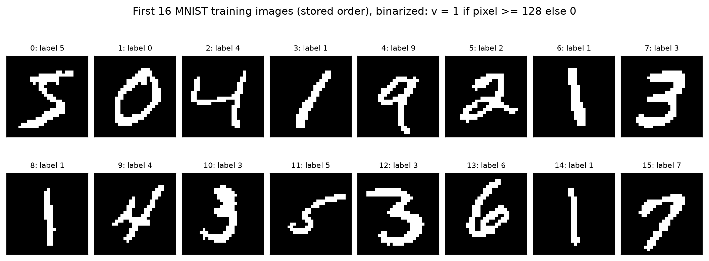

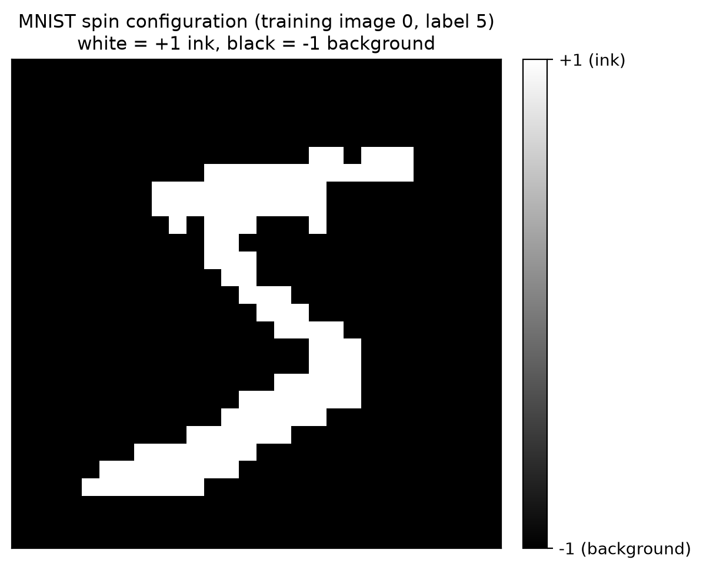

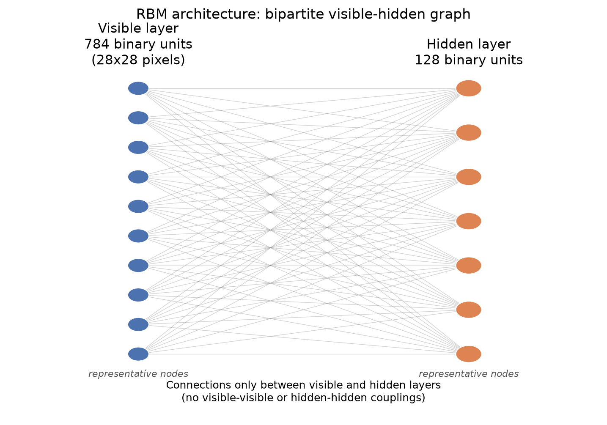

Reproduce with:

```sh
cd week6
uv run python rbm.py            # parse config, initialize, finite-value checks
uv run python verify1_figures.py  # writes the three figures to evidence/
uv run python -m pytest -q        # 65 tests
```

### VERIFY (1) results

- First 16 training labels in stored order:
  `[5, 0, 4, 1, 9, 2, 1, 3, 1, 4, 3, 5, 3, 6, 1, 7]` (matches the raw IDX files).
- Each image has exactly **784** visible binary units; values are `{0, 1}`.
- Spin values are strictly `{-1, +1}`; image 0 has both ink (+1) and
  background (−1).
- Weight matrix shape is **(784, 128)**; biases are `(784,)` and `(128,)`.
- Energy, free energy, conditional probabilities and Gibbs sampling all
  return finite values; energy/free-energy match brute-force enumeration on a
  small RBM.
- Architecture diagram has connections only between layers (70 representative
  visible-hidden lines for 10×7 drawn nodes) and none within a layer.

## Part 2 — VERIFY (2): CD-1 vs CD-10 training

`cd_training.py` trains two RBMs with **identical initialization** (seed 6601),
**identical data order** (per-epoch shuffles from training seed 6602) and the
same `rbm.toml` settings; only the Gibbs chain length differs (1 vs 10).

- **Optimizer:** plain SGD, learning rate 0.1, batch size 100, 20 epochs,
  float32, no momentum, no weight decay.
- **CD surrogate** (recorded before each update, averaged per epoch):
  `mean[F(v0) - F(stop_gradient(vk))]`, where `vk` is the visible state after
  `k` block-Gibbs steps started at the data batch. Minimizing this surrogate
  gives the standard CD update.
- **One-step reconstruction error** (held out, first 64 test images, fixed
  evaluation key from seed 6606): sample `h ~ P(h|v0)` and `v1 ~ P(v|h)`, then
  report `mean((v0 - v1)²)`.

> The CD surrogate is a stochastic approximation used as the training
> objective. It is **not** the exact negative log-likelihood: the partition
> function is intractable, so its value is never interpreted as an NLL.

### VERIFY (2) results

| Model | Initial recon. | Final recon. | Ratio | Runtime | Surrogate (first → last epoch) |
|-------|---------------:|-------------:|------:|--------:|-------------------------------:|
| CD-1  | 0.1708 | **0.0462** | 27.0% | 48.2 s | −17.3105 → −5.9360 |
| CD-10 | 0.1708 | **0.0474** | 27.7% | 203.4 s | −14.3526 → −5.0289 |

This matches the sheet's reference of approximately **0.17 → 0.047**. Both
models start from the same parameters (identical initial error) and CD-10
takes about 4× longer because each update runs 10 Gibbs steps instead of 1.

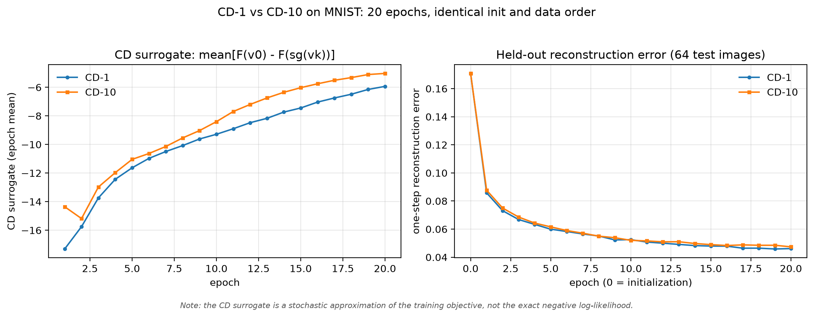

Verification status:

- Final reconstruction error is **< 50%** of the initial error for both models.
- All surrogate and reconstruction values are finite.
- CD-1 and CD-10 have identical initialization and identical data order.
- The CD surrogate is documented and annotated as approximate, not exact NLL.

Raw per-epoch metrics are written to `artifacts/cd_training_metrics.json`
(gitignored); the run log is `evidence/cd-training-verify.txt`.

## Part 2 — VERIFY (3): frozen reconstruction and fresh generation

`verify3_sampling.py` reuses the trained models. Parameters are loaded from
the checkpoints `artifacts/rbm_cd1.npz` and `artifacts/rbm_cd10.npz` (if a
checkpoint is missing, the script deterministically retrains with the exact
`rbm.toml` settings and saves it). **Parameters are frozen** during both
experiments: sampling only reads `W`, `a`, `b`.

- **Reconstruction:** one Gibbs step from the first 8 held-out test digits
  (fixed evaluation key, seed 6606): `h ~ P(h|v0)`, `v1 ~ P(v|h)`.
- **Fresh generation:** both models start from the *same* random ±1 spin
  configurations (8 chains, seed 6607), converted to visible bits
  `v = (s+1)/2`, and use the *same* per-step sampling keys. Visible states are
  recorded at steps **0, 1, 10, 100, 1000**. All 8 chains are shown; no best
  sample is selected.

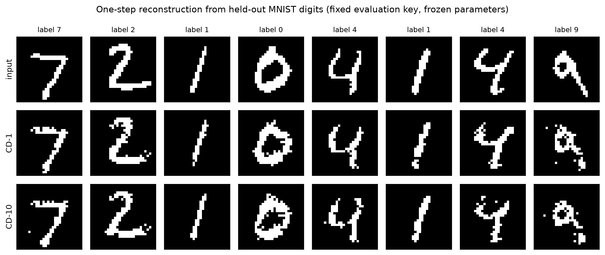

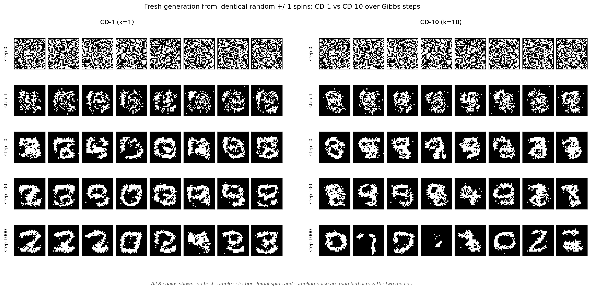

### VERIFY (3) results

Reconstruction MSE over the 8 held-out digits: **CD-1 0.0381**, **CD-10
0.0391** (both models reconstruct the strokes of the inputs).

Generation structure, mean over 8 chains (ink fraction / 4-connected ink
components / largest-component fraction):

| step | CD-1 | CD-10 |
|-----:|------|-------|
| 0    | 0.496 / 64.6 / 0.078 | 0.496 / 64.6 / 0.078 |
| 1    | 0.188 / 33.8 / 0.052 | 0.196 / 24.1 / 0.103 |
| 10   | 0.238 / 9.8 / 0.139  | 0.228 / 6.5 / 0.205  |
| 100  | 0.237 / 8.6 / 0.188  | 0.222 / 9.4 / 0.184  |
| 1000 | 0.227 / 7.4 / 0.156  | 0.164 / 5.0 / 0.142  |

**Effects of step count vs training k.** The number of Gibbs steps dominates:
for both models the random ±1 start (half the pixels on, ~65 disconnected
components) collapses within 10–100 steps into ~5–10 connected ink components
and a much larger largest blob, i.e. stroke-like structure rather than pixel
noise. Longer CD training helps early mixing modestly — CD-10 already has
fewer components and a larger blob after 1–10 steps — but by 1000 steps the
two models produce samples of comparable structure. Clean, recognizable
digits are not required and are not claimed.

Verification status:

- ✅ Both models start from **identical** random ±1 configurations (and use
  matched sampling noise).
- ✅ Model parameters are **frozen** during reconstruction and generation.
- ✅ Generated images develop **connected, stroke-like** ink structure
  (components fall, largest component grows).
- ✅ 8 chains recorded at every snapshot; no cherry-picking.

Raw results: `artifacts/verify3_sampling.json` and
`artifacts/verify3_snapshots.npz` (gitignored). Run log:
`evidence/verify3-summary.txt`.

## Part 2 — VERIFY (4): image completion with clamped upper halves

`verify4_completion.py` reuses the frozen CD-1/CD-10 checkpoints and the
`rbm.toml` settings.

- **Data:** first **64** held-out MNIST test images (seed 6607).
- **Clamping:** the upper **14 rows** are observed and restored after *every*
  Gibbs step; the lower **14 rows** start from random bits and are sampled.
- **Chains:** **8 independent chains per image**; all runs share identical
  initial lower-half randomness and matched per-step noise keys.
- **Steps:** recorded after **1, 10, 100, 1000** Gibbs steps.
- **Overlap:** Dice coefficient on the lower half,
  `2|A n B| / (|A| + |B|)`, averaged over each image's 8 chains; error bars
  are standard errors across the 64 images.
- **Wrong upper:** the upper half of the next test image with a **different
  label** (wrapping inside the 64 images); the evaluation target stays the
  original image's true lower half.

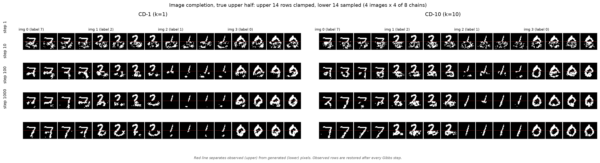

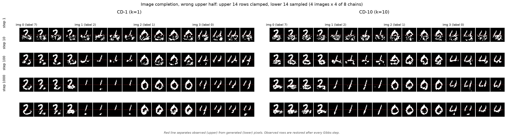

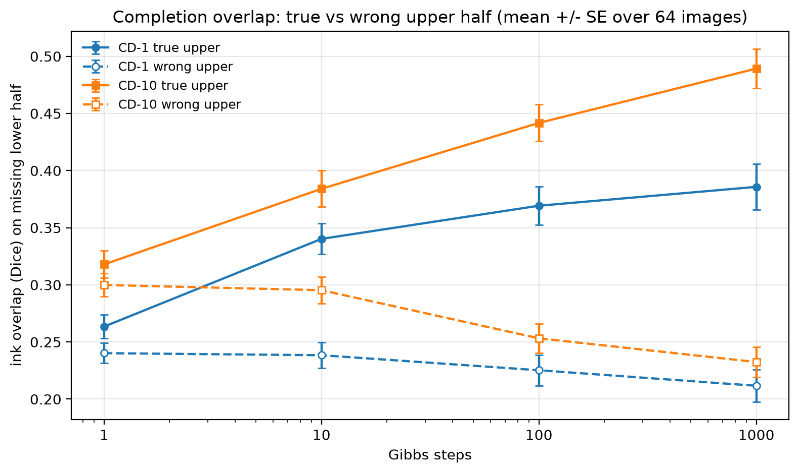

### VERIFY (4) results

Lower-half Dice overlap, mean ± SE over 64 images:

| Condition | 1 step | 10 steps | 100 steps | 1000 steps |
|-----------|:------:|:--------:|:---------:|:----------:|
| CD-1 true upper  | 0.263 ± 0.010 | 0.340 ± 0.013 | 0.369 ± 0.017 | **0.386 ± 0.020** |
| CD-1 wrong upper | 0.240 ± 0.009 | 0.238 ± 0.011 | 0.225 ± 0.013 | **0.212 ± 0.014** |
| CD-10 true upper  | 0.318 ± 0.012 | 0.384 ± 0.016 | 0.442 ± 0.016 | **0.489 ± 0.017** |
| CD-10 wrong upper | 0.300 ± 0.010 | 0.295 ± 0.012 | 0.253 ± 0.013 | **0.232 ± 0.013** |

At 1000 steps the true-upper over wrong-upper gap is **0.174** for CD-1 and
**0.257** for CD-10, both well above the required 0.1. This is close to the
sheet's reference (CD-1 0.40 vs 0.24; CD-10 0.51 vs 0.27; the small offset
comes from the sampled lower-half initialization and noise realization).

Verification status:

- ✅ Observed upper pixels are unchanged after every Gibbs step (checked at
  bit level for all 64 images, 8 chains and 4 step counts, both conditions).
- ✅ True-upper overlap increases monotonically with sampling steps.
- ✅ At 1000 steps, true-upper overlap exceeds wrong-upper overlap by ≥ 0.1
  for **both** models (0.174 and 0.257).
- ✅ Standard errors are reported across the 64 test images.

Raw data: `artifacts/verify4_completion.json` (means, SEs, per-image overlaps)
and `artifacts/verify4_snapshots.npz` (per-chain overlaps and gallery
snapshots), both gitignored. Run log: `evidence/verify4-summary.txt`.

## Part 3 — VERIFY (1): classical Hopfield network

`hopfield.py` implements the model in JAX and `hopfield_experiment.py` runs
the storage-load sweep.

- **Model:** `N` spins `±1`; `P` independent random `±1` patterns; Hebbian
  couplings `J = X^T X / N` (equivalently `X X^T / N` with patterns as
  columns), explicitly symmetrized and with `J_ii = 0`.
- **Async zero-temperature recall:** one random spin at a time, sign update,
  stops when a full sweep causes no flips; `h_i = 0` leaves the spin
  unchanged.
- **Unstable bits:** fraction of stored-pattern bits with `xi_i h_i < 0`,
  compared with the Gaussian prediction `Phi(-1/sqrt(alpha))`.
- **Sweep:** `N ∈ {100, 200, 400, 800}`, `alpha = P/N` from **0.05 to 0.25**
  in **0.01** steps, **20 independent pattern sets** per point, seed **5315**.

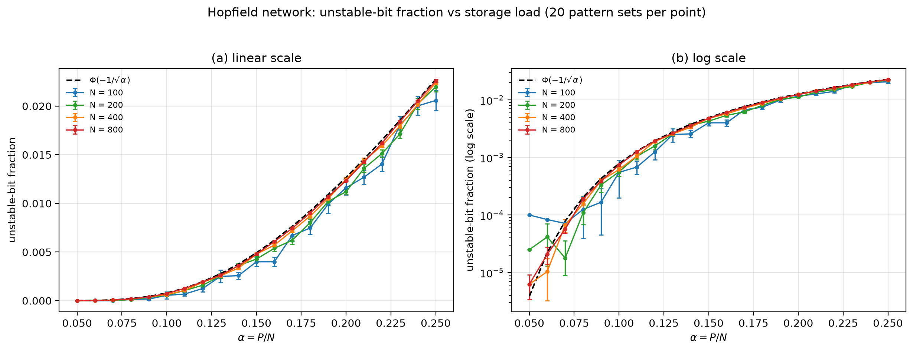

### VERIFY (1) results

Mean absolute deviation from `Phi(-1/sqrt(alpha))` over the 21 alpha values:

| N | mean abs. deviation |
|---:|--------------------:|
| 100 | 0.00090 |
| 200 | 0.00060 |
| 400 | 0.00026 |
| 800 | 0.00013 |

Selected points (measured mean ± SE over 20 pattern sets):

| alpha | theory | N=100 | N=200 | N=400 | N=800 |
|------:|-------:|-------|-------|-------|-------|
| 0.10 | 0.0008 | 0.0006 ± 0.0004 | 0.0006 ± 0.0001 | 0.0006 ± 0.0001 | 0.0007 ± 0.0000 |
| 0.15 | 0.0049 | 0.0040 ± 0.0005 | 0.0043 ± 0.0003 | 0.0048 ± 0.0002 | 0.0048 ± 0.0001 |
| 0.20 | 0.0127 | 0.0116 ± 0.0007 | 0.0112 ± 0.0003 | 0.0125 ± 0.0002 | 0.0123 ± 0.0001 |
| 0.25 | 0.0228 | 0.0206 ± 0.0010 | 0.0220 ± 0.0005 | 0.0224 ± 0.0002 | 0.0226 ± 0.0001 |

Verification status:

- ✅ `J` is symmetric with zero diagonal (checked exactly).
- ✅ Stored patterns are independent random `±1` (tested for values, shape and
  small mutual overlap).
- ✅ Numerical curves approach the Gaussian prediction as `N` increases;
  the deviation falls monotonically 0.00090 → 0.00013.
- ✅ Consistent with the page-13 reference behaviour: at `alpha = 0.25` the
  `N = 800` curve gives 0.0226 against the theoretical 0.0228, and finite-size
  deviations are largest for `N = 100`.

Raw numerical data (all means, SEs and per-set values):
`artifacts/hopfield_unstable_fraction.json` (gitignored). Run log:
`evidence/hopfield-verify1-summary.txt`.

## Part 3 — VERIFY (2): recall capacity

`hopfield_recall.py` reuses the VERIFY (1) pattern sets (same seed **5315**
and keys) and the asynchronous zero-temperature recall.

- For each `(N, alpha)` point and each of the 20 pattern sets, recall starts
  from the first `min(10, P)` stored patterns and runs until a full sweep
  causes no flips.
- Recorded per set: mean final overlap with the original pattern and the
  recall success rate (`overlap >= 0.9`).
- **Threshold crossing** is the alpha where the mean final overlap falls
  through the same **0.9** level (linear interpolation); this is the
  definition that reproduces the sheet references 0.186, 0.170, 0.156, 0.150.

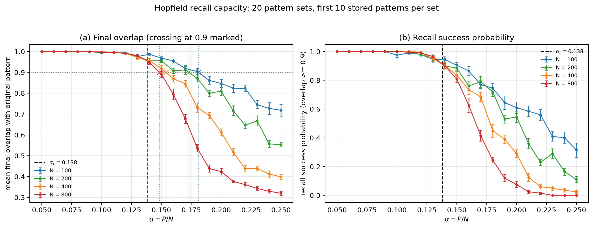

### VERIFY (2) results

| N | estimated crossing | reference | difference | success at α=0.05 | success at α=0.25 |
|---:|-------------------:|----------:|-----------:|------------------:|------------------:|
| 100 | **0.1810** | 0.186 | 0.0050 | 1.000 | 0.315 |
| 200 | **0.1729** | 0.170 | 0.0029 | 1.000 | 0.110 |
| 400 | **0.1538** | 0.156 | 0.0022 | 1.000 | 0.025 |
| 800 | **0.1485** | 0.150 | 0.0015 | 1.000 | 0.000 |

Transition width (alpha at success 0.5 minus alpha at success 0.9):

| N | width |
|---:|---:|
| 100 | 0.0728 |
| 200 | 0.0624 |
| 400 | 0.0372 |
| 800 | 0.0260 |

Near/above capacity (`alpha = 0.20`): mean overlap 0.847/0.810/0.613/0.424
and success 0.610/0.545/0.290/0.075 for N = 100/200/400/800.

Verification status:

- ✅ Recall is essentially perfect at low alpha (success = 1.000 at α = 0.05).
- ✅ Final overlap and success decrease near the storage capacity.
- ✅ The transition becomes **sharper as N increases** (width 0.0728 → 0.0260).
- ✅ Estimated crossings **decrease with N** (0.1810 → 0.1485).
- ✅ Each crossing differs from its reference by **< 0.02** (max 0.0050).
- ✅ `alpha_c = 0.138` is marked on both panels.

Raw data: `artifacts/hopfield_recall_capacity.json` (means, SEs, per-set
values, crossings; gitignored). Run log: `evidence/hopfield-recall-summary.txt`.

## Part 4 — VERIFY (1): modern Hopfield update as softmax attention

`modern_hopfield.py` stores the first `P` MNIST training images in original
order as binarized ±1 spins, shape `(P, 784)`, and implements

```
x_new = X^T @ softmax(beta * (X @ x))
```

The equivalent JAX attention call uses query `x`, keys = values = stored
patterns, and an explicit **`scale=beta`** (not the default `1/sqrt(d)`):
`jax.nn.dot_product_attention(..., scale=beta)`.

Tested grid: `P ∈ {3, 10, 30, 100, 300, 1000}`, `beta ∈ {0.001, 0.003,
0.01, 0.03, 0.1, 0.3, 1}`, with 20 held-out test images as queries.

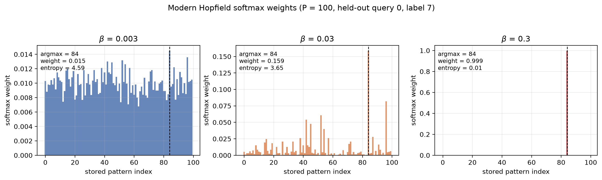

### VERIFY (1) results

- Maximum absolute difference between the manual update and JAX softmax
  attention across **all 20 queries × 6 P × 7 beta**: **2.801 × 10⁻⁶**
  (< 1 × 10⁻⁵).
- Maximum `|sum(weights) − 1|`: **4.768 × 10⁻⁷**.

Softmax weights for `P = 100` and one held-out query (label 7):

| beta | top weight | entropy (nats) | argmax pattern |
|-----:|-----------:|---------------:|---------------:|
| 0.003 | 0.0145 | 4.594 | 84 |
| 0.03 | 0.1588 | 3.647 | 84 |
| 0.3 | 0.9985 | 0.011 | 84 |

Verification status:

- ✅ Maximum implementation difference **< 1e-5** (2.8e-6).
- ✅ Softmax weights sum to 1 for every query, P and beta.
- ✅ Larger beta concentrates weight on the **most similar stored pattern**
  (top weight rises and entropy falls); the argmax always equals the
  most-similar pattern index.
- ✅ The attention implementation uses `scale=beta`; a default-scale call
  differs measurably, so the scale is not accidentally the default.
- ✅ Consistent with the page-15 behaviour: attention weights are a proper
  distribution over stored patterns and sharpen toward the best match as beta
  increases.

Raw data: `artifacts/modern_hopfield_attention.json` (per-point differences,
weight sums, concentration metrics and plotted weights; gitignored). Run log:
`evidence/modern-hopfield-verify1-summary.txt`.

## How to reproduce

```sh
cd week6
uv sync                                        # JAX CPU environment (Python 3.14)
uv run python prepare_data.py                  # download + checksum + parse
uv run python plot_mnist_distribution.py       # Part 1 VERIFY (1) figure
uv run python plot_cifar10_distribution.py     # Part 1 VERIFY (2) figure
uv run python rbm.py                           # RBM basics + finite checks
uv run python verify1_figures.py               # Part 2 VERIFY (1) figures
uv run python cd_training.py                   # Part 2 VERIFY (2): CD-1 vs CD-10
uv run python verify3_sampling.py              # Part 2 VERIFY (3): frozen sampling
uv run python verify4_completion.py            # Part 2 VERIFY (4): completion
uv run python hopfield_experiment.py           # Part 3 VERIFY (1): alpha sweep
uv run python hopfield_recall.py               # Part 3 VERIFY (2): capacity
uv run python modern_hopfield_experiment.py    # Part 4 VERIFY (1): attention
uv run python -m pytest -q                     # 120 tests
```

`prepare_data.py` is idempotent: files that already exist with the correct MD5
are reused. Downloads are written to a temporary `.part` file and renamed only
after the checksum matches.

## Notes

- Datasets live in `inputs/` and are **gitignored** (only `.gitkeep` is
  tracked); `.venv/` is also ignored. Re-run `prepare_data.py` after a fresh
  clone.
- Environment quirk: the WSL resolver in this machine drops DNS lookups for
  `storage.googleapis.com`. `prepare_data.py` detects that and resolves the
  host through a public DNS server while keeping the original hostname for TLS
  (SNI and certificate validation are unchanged).
- Scope: Part 1 dataset preparation and distribution figures, Part 2 basic
  RBM and VERIFY (1)–(4), Part 3 Hopfield VERIFY (1)–(2), and Part 4
  VERIFY (1) modern Hopfield/attention. Part 4 VERIFY (2)–(3) and the final
  verification are not implemented yet.
